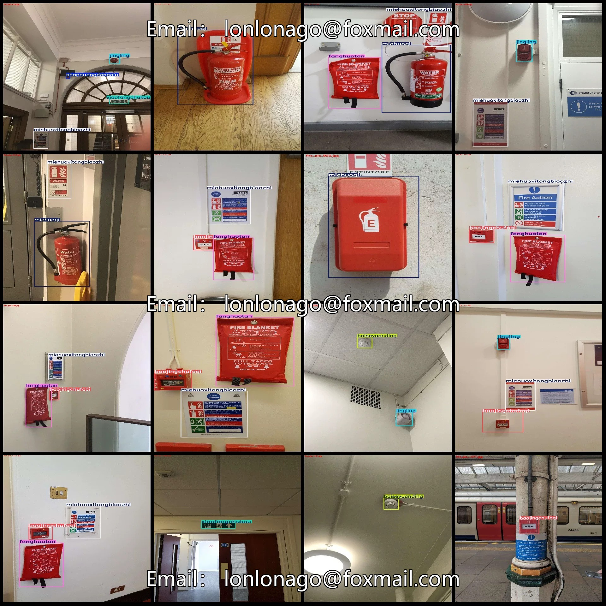
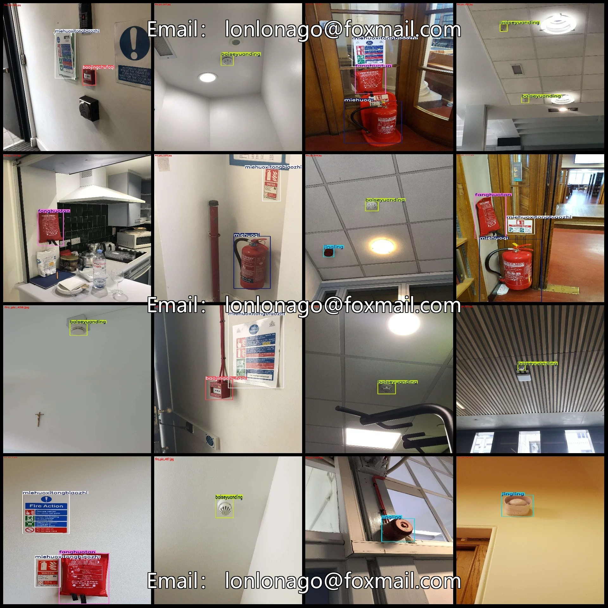
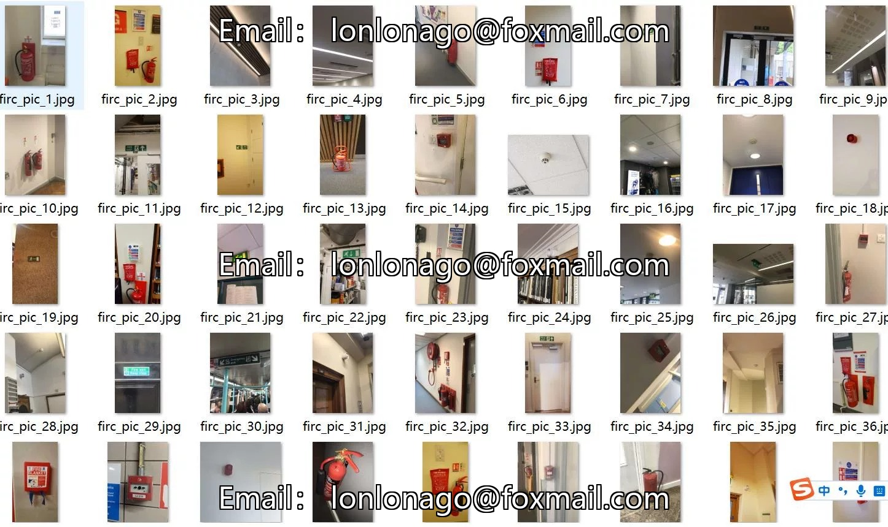
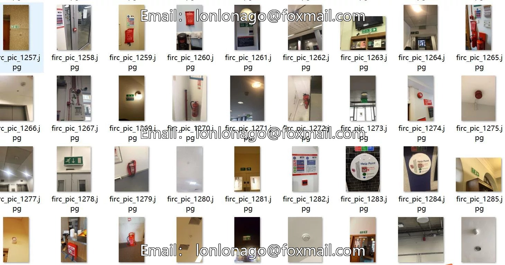
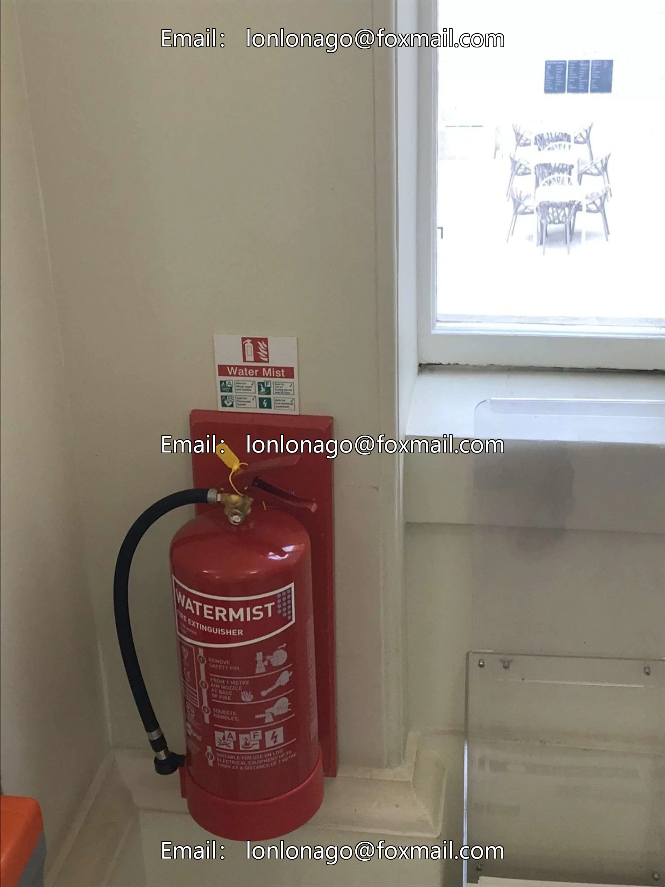
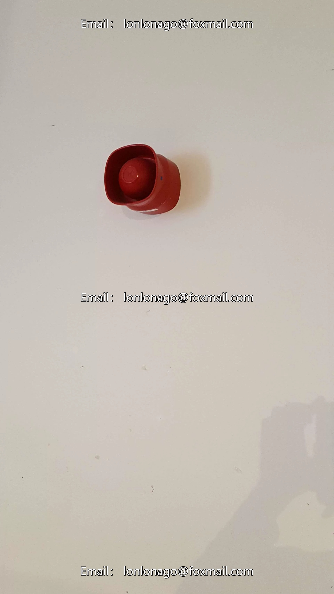
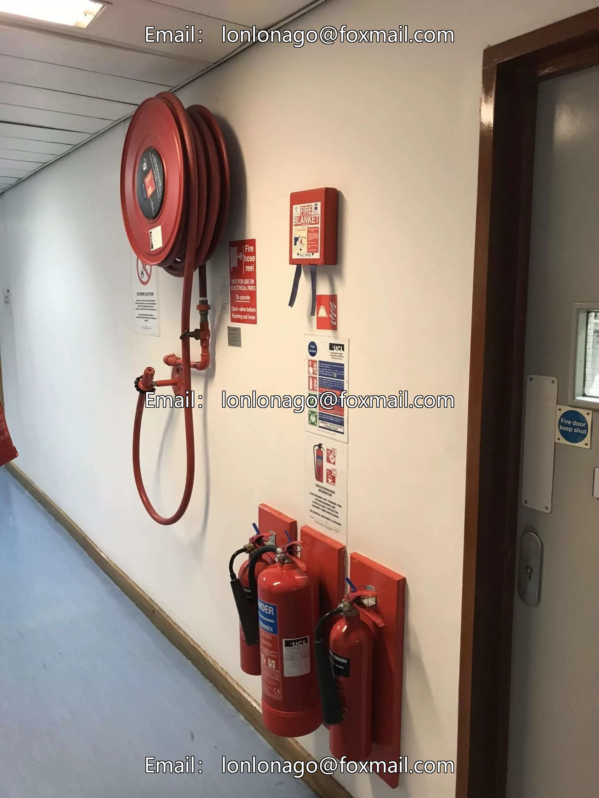

# Fire Safety Equipment Inspection Dataset VOC+YOLO format with 1444 images in 8 categories

## Body

Fire Safety Equipment Inspection Data Set - VOC+YOLO format with 1444 images in 8 categories
Tips: Due to the dataset's replicability, please confirm compliance before purchasing.
Dataset format: Pascal VOC format + YOLO format (txt files without split paths, only containing jpg images and corresponding VOC format xml files and yolo format txt files)
Number of images (number of jpg files): 1444
Number of annotations (number of xml files): 1444
Number of annotations (number of txt files): 1444
Number of annotation categories: 8

Label category names (Note that the order of categories in the YOLO format does not correspond to this, but is based on the "labels" folder's "classes.txt"): ["baiseyuanding", "baojingchufaqi", "fanghuotan", "jingling", "miehuoqi", "miehuoxitongbiaozhi", "shanguangdengqiu", "xiaofangchukou"]
Corresponding Chinese category names: ["White dome", "Alarm tripwire", "Fire blanket", "Alert bell", "Fire extinguisher", "Fire suppression system sign", "Flashlight ball", "Fire exit"]

Number of boxes and the number of images occupied by each category
baiseyuanding: 314 boxes, 290 images
baojingchufaqi: 388 boxes, 385 images
fanghuotan: 225 boxes, 222 images
jingling: 281 boxes, 280 images
miehuoqi: 373 boxes, 264 images
miehuoxitongbiaozhi: 584 boxes, 457 images
shanguangdengqiu: 41 boxes, 38 images

Xiaofangchukou Frames = 315, Pictures Count = 284
Total Frames: 2521
Image Resolution: Multi-resolution images, such as 1920x3413, 1920x2560, etc.
Labeling Tool: labelImg
Labeling Rules: Draw a rectangle around the category.
Important Notice: The dataset does not have separate training, validation, and test sets; you need to partition them yourself.
Special Remark: This dataset does not guarantee the accuracy of the trained models or weight files.

## Images

## Payment

Here is a pay link on Stripe ( https://buy.stripe.com/3cs8yP7sY87d0vu9AB ). Please contact me lonlonago@foxmail.com after funding $89, and I will send you a complete data files , thank you!

